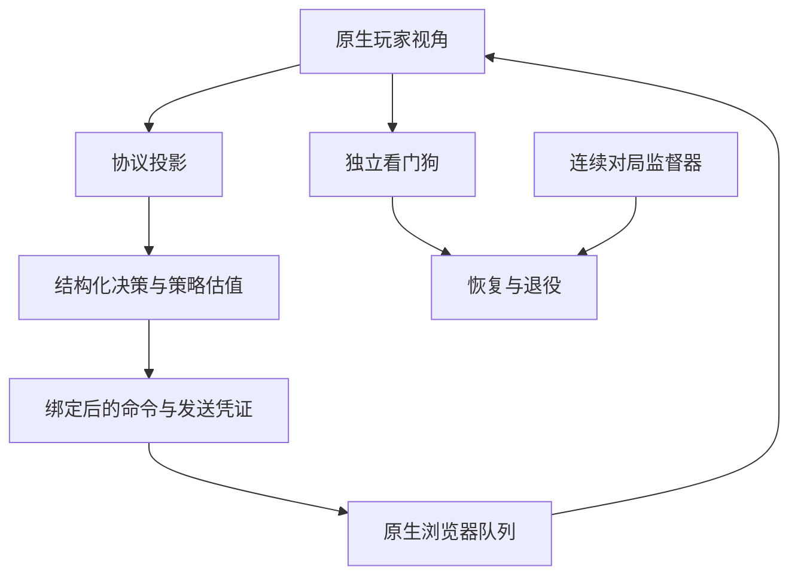

# 架构

远端 Keyteki 兼容服务器负责规则裁定。本包读取己方的原生玩家视角，从当前提供的动作中选择，编译成原生命令，并等待能够证明实际进展的后续证据。

## 模块

- `src/adapters`：玩家状态投影、集中管理的原生提示兼容、菜单导航、分配操作、卡牌身份绑定和命令编译。
- `src/ai`：启发式策略，以及区分准备、派发和确认阶段的策略控制器。
- `src/contracts`：玩家视角和决策相关的数据类型，不包含可执行的对局状态或权威规则引擎。
- `src/knowledge`：完整静态卡牌知识、数据类型、结构化能力分类、公开公式求值和查询接口。
- `src/shared`：协议与策略边界所需的确定性序列化函数，不执行对局重放。
- `tools`：本机回环宿主、浏览器桥接、用户脚本、看门狗、房间生命周期、连续对局监督器和恢复命令。

## 0.6.0 的决策语义分层

0.6.0 建立了以下分层；0.6.1 继续沿用，并补充公开数量求值和随机效用估计：

| 层次 | 主要入口 | 职责 |
| --- | --- | --- |
| 结构化决策合同 | `src/contracts/observation.ts` | 用 `pending.intent`、选项的 `house` 和公开来源绑定描述当前步骤，保留服务器或裁判实际提供的动作 ID。 |
| 结构化策略语义 | `src/knowledge/semantic-features.ts` 与 `src/ai` | 从静态规则节点、己方/敌方、选择绑定及公开字段提取能力特征，再结合当前决策估值；保留条件性与未知信息。 |
| 集中原生兼容 | `src/adapters/keyteki-native-semantics.ts` 及其适配器调用方 | 优先使用原生控件、参数、图标和物理身份；对协议没有明确类型字段的提示与日志使用有限的已知模板，并核对当前来源和时序。 |

外服输入先经过原生兼容与协议投影，形成决策合同，再交给策略。自有测试裁判在独立规则项目中，可以直接根据实际执行步骤生成同一公共合同。本包消费这些观察，不包含该裁判的可执行状态推进逻辑。

### 当前步骤与公开来源

`house-choice` 说明当前确实在选阵营；`target-operation` 说明当前明确的目标操作。预言翻面和 Cauldron 下方牌的选择也有独立语义。策略据此识别步骤，不再用 `Choose a house`、按钮翻面文案或 `Cauldron:` 前缀代替当前含义。

需要解释更完整的续段时，自有裁判可提供一个公开规则位置：`effect-choice` / `effect-selection` 携带 `ability` 和 `path`，部分其他 intent 使用可选的 `selection`。该位置必须来自**当前观察者已经可见的源卡静态定义**，并与**当前执行步骤**去掉显示标签后唯一精确匹配。来源隐藏、重复的同构分支、无法匹配的动态步骤，或超过检查边界的内容都不生成这个位置。单纯知道源卡身份，或发现该卡只有一段 `chooseHouse`，不足以绑定当前续段。

这个位置只是已公开规则树的索引。投影不包含内部 `frame`、私有 bindings、隐藏物理引用、入场序号或预言 serial；私有提示继续使用同一可见性过滤。没有续段位置时，仍可使用已证明的较窄语义，例如真实提供的阵营选项，但不借用另一段规则补齐含义。

### 能力分类与兼容回退

结构化能力分类描述牌具有的潜在能力，例如控琥珀、抽牌、治疗或准备使用。条件分支、未来触发和未知公式仍需要独立处理，能力标签不保证这些效果会在当前动作中兑现。规则数据完整程度、分类器识别的节点种类和数值估值覆盖是不同口径，详见[卡牌知识与策略范围](card-knowledge.md)。

`unknown` 表示当前语义或估值尚不能可靠确定。远端裁判仍提供合法动作并执行规则，策略可以利用其他已知信息与回退排序；这不等于该牌不能运行。若连当前原生命令或物理目标都无法可靠绑定，则属于适配器的独立不支持状态，由原有控制和恢复机制处理。

集中兼容层仍保留必要的原生提示与日志文字模板。例如，选阵营优先读取控件阵营列表、数字参数或按钮图标；原生协议缺少事件类型时，调用方还必须核对参与者、物理来源、当前提示、目标及新鲜的事件窗口。模板命中不能替代这些绑定。策略分支直接消费投影后的语义，显示标签继续保留用于界面、日志和说明。

0.6.0 的迁移与验证边界见[结构化策略语义](structured-strategy-semantics.md)。

## 0.6.1 的公开数量求值

0.6.1 在上述边界内共享一套数量与条件解释接口：`src/knowledge/public-formula.ts` 提供 `evaluatePublicValue()`、`evaluatePublicCondition()` 和 `selectPublicCards()`；`public-formula-context.ts` 负责从玩家观察构造当前场面及明确的打出、使用后投影。能力分类器可接收同一个公开上下文，数值估值器则把可确定的数量用于实际动作排序。

例如，按当前场上阵营数获得琥珀、计算准备中的火星生物、读取公开护甲或已捕获琥珀，都应随场面变化。上下文相关结果不放入卡牌定义的静态缓存。相同卡牌在两个不同场面中可以得到不同数量；界面说明、卡文和提示标签不参与公式识别。

### 结果保留信息的确定程度

| 结果 | 含义 | 策略使用边界 |
| --- | --- | --- |
| `exact` | 当前公开信息及明确投影足以确定数值，包括确定的零。 | 可以用于对应的数量、比较、次数或资源封顶；零不会被默认改成一。 |
| `expected` | 有明确的概率模型及离散结果，可以计算平均数值或效用。 | 保留结果分布、范围与假设，不把均值当成某一局必然发生的数量。 |
| `interval` | 只能确定上下界，不能给出各结果的概率。 | 不擅自取区间中点作为期望，不借此认证阈值已满足。 |
| `unknown` | 缺少当前绑定、公开计数、身份、事件上下文或已实现的预测语义。 | 保留原因；它与已知零不同，也不表示远端规则不能执行。 |

当前通用 `value()` 数值消费者只接收 `exact`。遇到非精确结果时，它记录原因和不确定性，但数量槽仍使用 **0 占位**；因此，本版没有消除所有未知数量的零占位。这个占位不把整张牌的收益清零，也不是该效果已知没有作用的结论。随机期望通过独立的逐结果分支或线性效用路径进入排序；卡牌的其他已知收益、印刷数值以及结构上可识别的条件能力潜力仍然保留。

独立观察没有公开的事件量、历史计数或当前绑定时，不能因为字段缺失就补出精确零。事件持有者或上一张牌的持有者不明，也不能把资源自动算给自己。已知的 `active` 则按观察中的当前活动玩家解释。

### 当前场面与有界续段投影

实际打出或使用后的场面只准备一次。正在打出的物理牌从原区域移除；两张巨大生物组件按实际来源分别计数，不能一律当作少一张手牌。新入场生物的准备状态、计数器和复制特征需要按已知规则处理，不能照搬手牌视图中的状态，也不能把复制对象现有的伤害、计数器和使用次数当作物理来源的状态。

策略已有的资源池、手牌数量、档案数量、选择绑定、实际花费和捕获上限继续沿着当前估值步骤更新。后一个公式读取更新后的投影，不重新读取最初观察中的旧数值。显式的零、截零减法和允许负数的 `negate` 按各自语义处理。明确成功的准备、横置与眩晕会更新后续筛选。已知捕获量增减后，依赖捕获量的力量也随当前公开特征、力量指示物和数量公式刷新；已有场上生物与刚入场来源都经过同一依赖处理。捕获分配尚未确定时，只有相关依赖失去确定性，已知普通生物仍可保留在数量区间的下界中。外部力量修饰、未知复制或其它尚不能可靠投影的变化继续保留具体不确定原因。

`withValue` 保存当前公开计算的标量，`forEach` 使用已确定的次数，子续段的 `lastAmount` 和临时绑定有各自作用域。一个目标组的操作数量仍在同一来源上下文中求值，不把目标卡替换成来源卡来重复计算。公开离区后重新选择的牌可以在新区域参与后续操作，旧绑定不会自动跟随同一物理 ID 到新入场。这里使用的局部版本只记录估值器自己已知的公开操作，不读取或输出裁判的内部入场序号、`frame` 或私有 bindings。

Haunted 是区域数量及公开启用者的派生状态。连续操作改变弃牌、清除区或场上启用者后，后续判断读取更新后的投影，不沿用观察开始时的布尔缓存。例如 Stratowise 在九张弃牌时弃掉一张，后续捕获条件应按十张弃牌重新判断；反向离开十张阈值也会重新判断。区域数量或相关启用者仍不确定时，不将旧缓存误当成当前的确定结果。

当前两条常用策略都经过这条数值路径：`tactical-card-effects-v3` 从 `rankCardAwareV3()` 进入；`tactical-style-engine-v3` 由 `rankStyleUpgrade()` 调用既有前置风格策略，再进入同一基础估值器，并保留其额外公开修正。V3 对少量卡的专门处理没有把普通牌排除在共享公式求值之外。通用 persona 风格入口与这个 V3 风格策略入口分别维护；本次没有通过调整这些策略的权重来替代数量修复。

### 随机效果按结果计算效用

随机绑定对公开且完整的集合最多枚举 32 个等概率候选，先对每个具体候选执行可估值的续段，再平均效用；资源上限、条件比较和循环次数在各自结果内计算。例如，偷取数量等概率为 1 或 9、对方只有 5 琥珀时，预计偷取量为 `(1 + 5) / 2 = 3`，不能先把数量平均成 5 再封顶。

随机结果合并后，共同且明确的区域与字段继续保留；存在分歧的位置、资源池或身份依赖则标记为不确定。后续步骤不能再次拿平均资源过确定性阈值。需要完整联合续段才能判断的随机铸钥、钥匙费用变化等，仍保留未知，不认证成功。

`randomDiscard` 的默认接收者是自己，数量受实际区域和可用牌数限制；`randomArchive` 从手牌取样。公开完整样本可以对既有单卡效用计算均值。对手隐藏手牌只有数量时，只能使用明确标注的匿名数量模型，不能编造牌种、奖励图标或牌面概率。有 Scrap、弃牌响应或观察覆盖缺失时，静态取样不能保证后续分布不变；直接操作估计保留假设，依赖这些响应的续段继续未知。`randomDeckTop` 则是所有匹配且仍在场的目标回到各自牌库顶，随机的是顶牌顺序，不能把它误当成只随机移走一张。

这些接口用于有限策略估值，不承担完整规则结算。实现范围、已知限制和各轮证据集中见[公开公式与随机估值](contextual-formula-evaluation.md)及[对应脱敏数据](evidence/contextual-formulas-2026-11-17.json)。

## 发送与恢复

准备好决策、浏览器队列接受命令、在后续状态中观察到效果，是三个独立事件。网络请求返回不能单独证明游戏动作已经执行或尚未执行。页面文档 ID、控制权代次、序号、决策 ID 和发送凭证，将每个阶段绑定到同一个控制方和同一条具体动作。

已观察回执恢复流程，只有在宿主保留了完整原始派发的精确证明时，才能清除送达不确定状态。它不会重放原命令，也不会额外制造一次效果确认。对账后，旧页面仍保持暂停，直到受控刷新完成，并接受新的完整原生状态。回执缺失或不匹配、控制方变化、存在待处理命令、存储失败或操作者暂停，都会保留不确定状态。

看门狗独立于普通策略请求队列观察原生进展。连续对局监督器控制后续开局及健康阈值，不会绕过对局内尚未解决的发送不确定性。

## 信息边界

策略可使用己方可见的手牌和档案，以及对手公开信息。它不会接收对手隐藏区域、服务器随机数状态或权威对局状态对象。完整静态卡牌知识不会提供当前对局中隐藏的物理牌顺序或身份。

历史战绩与当前版本验证分开记录。本独立包实际执行过哪些检查，见[验证记录](validation.md)。
