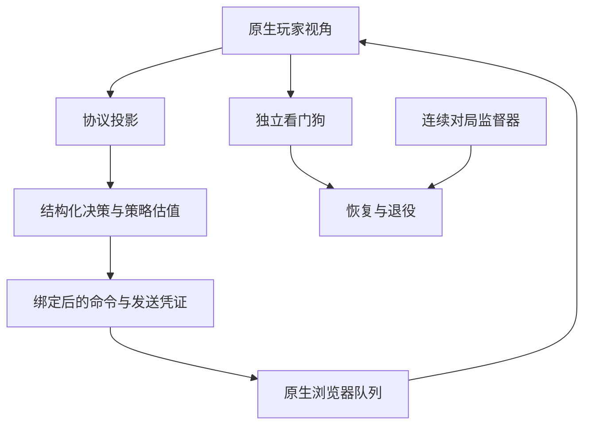

# 架构

远端 Keyteki 兼容服务器负责规则裁定。本包读取己方的原生玩家视角，从当前提供的动作中选择，编译成原生命令，并等待能够证明实际进展的后续证据。

## 模块

- `src/adapters`：玩家状态投影、集中管理的原生提示兼容、菜单导航、分配操作、卡牌身份绑定和命令编译。
- `src/ai`：启发式策略，以及区分准备、派发和确认阶段的策略控制器。
- `src/contracts`：玩家视角和决策相关的数据类型，不包含可执行的对局状态或权威规则引擎。
- `src/knowledge`：完整静态卡牌知识、数据类型、结构化能力分类和查询接口。
- `src/shared`：协议与策略边界所需的确定性序列化函数，不执行对局重放。
- `tools`：本机回环宿主、浏览器桥接、用户脚本、看门狗、房间生命周期、连续对局监督器和恢复命令。

## 0.6.0 的决策语义分层

0.6.0 将当前决策的含义、策略对规则的理解，以及外服协议的提示兼容分开维护：

| 层次 | 主要入口 | 职责 |
| --- | --- | --- |
| 结构化决策合同 | `src/contracts/observation.ts` | 用 `pending.intent`、选项的 `house` 和公开来源绑定描述当前步骤，保留服务器或裁判实际提供的动作 ID。 |
| 结构化策略语义 | `src/knowledge/semantic-features.ts` 与 `src/ai` | 从静态规则节点、己方/敌方、选择绑定及公开字段提取能力特征，再结合当前决策估值；保留条件性与未知信息。 |
| 集中原生兼容 | `src/adapters/keyteki-native-semantics.ts` 及其适配器调用方 | 优先使用原生控件、参数、图标和物理身份；对协议没有明确类型字段的提示与日志使用有限的已知模板，并核对当前来源和时序。 |

外服输入先经过原生兼容与协议投影，形成决策合同，再交给策略。自有测试裁判在独立规则项目中，可以直接根据实际执行步骤生成同一公共合同。本包消费这些观察，不包含该裁判的可执行状态推进逻辑。

### 当前步骤与公开来源

`house-choice` 说明当前确实在选阵营；`target-operation` 说明当前明确的目标操作。预言翻面和 Cauldron 下方牌的选择也有独立语义。策略据此识别步骤，不再用 `Choose a house`、按钮翻面文案或 `Cauldron:` 前缀代替当前含义。

需要解释更完整的续段时，自有裁判可提供一个公开规则位置：`effect-choice` / `effect-selection` 携带 `ability` 和 `path`，部分其他 intent 使用可选的 `selection`。该位置必须来自**当前观察者已经可见的源卡静态定义**，并与**当前执行步骤**去掉显示标签后唯一精确匹配。来源隐藏、重复的同构分支、无法匹配的动态步骤，或超过检查边界的内容都不生成这个位置。单纯知道源卡身份，或发现该卡只有一段 `chooseHouse`，不足以绑定当前续段。

这个位置只是已公开规则树的索引。投影不包含内部 `frame`、私有 bindings、隐藏物理引用、入场序号或预言 serial；私有提示继续使用同一可见性过滤。没有续段位置时，仍可使用已证明的较窄语义，例如真实提供的阵营选项，但不借用另一段规则补齐含义。

### 能力分类与兼容回退

结构化能力分类描述牌具有的潜在能力，例如控琥珀、抽牌、治疗或准备使用。条件分支、未来触发和未知公式仍需要独立处理，能力标签不保证这些效果会在当前动作中兑现。规则数据完整程度、分类器识别的节点种类和数值估值覆盖是不同口径，详见[卡牌知识与策略范围](card-knowledge.md)。

`unknown` 表示当前语义或估值尚不能可靠确定。远端裁判仍提供合法动作并执行规则，策略可以利用其他已知信息与回退排序；这不等于该牌不能运行。若连当前原生命令或物理目标都无法可靠绑定，则属于适配器的独立不支持状态，由原有控制和恢复机制处理。

集中兼容层仍保留必要的原生提示与日志文字模板。例如，选阵营优先读取控件阵营列表、数字参数或按钮图标；原生协议缺少事件类型时，调用方还必须核对参与者、物理来源、当前提示、目标及新鲜的事件窗口。模板命中不能替代这些绑定。策略分支直接消费投影后的语义，显示标签继续保留用于界面、日志和说明。

本轮迁移与验证边界见[结构化策略语义](structured-strategy-semantics.md)。

## 发送与恢复

准备好决策、浏览器队列接受命令、在后续状态中观察到效果，是三个独立事件。网络请求返回不能单独证明游戏动作已经执行或尚未执行。页面文档 ID、控制权代次、序号、决策 ID 和发送凭证，将每个阶段绑定到同一个控制方和同一条具体动作。

已观察回执恢复流程，只有在宿主保留了完整原始派发的精确证明时，才能清除送达不确定状态。它不会重放原命令，也不会额外制造一次效果确认。对账后，旧页面仍保持暂停，直到受控刷新完成，并接受新的完整原生状态。回执缺失或不匹配、控制方变化、存在待处理命令、存储失败或操作者暂停，都会保留不确定状态。

看门狗独立于普通策略请求队列观察原生进展。连续对局监督器控制后续开局及健康阈值，不会绕过对局内尚未解决的发送不确定性。

## 信息边界

策略可使用己方可见的手牌和档案，以及对手公开信息。它不会接收对手隐藏区域、服务器随机数状态或权威对局状态对象。完整静态卡牌知识不会提供当前对局中隐藏的物理牌顺序或身份。

历史战绩与当前版本验证分开记录。本独立包实际执行过哪些检查，见[验证记录](validation.md)。
