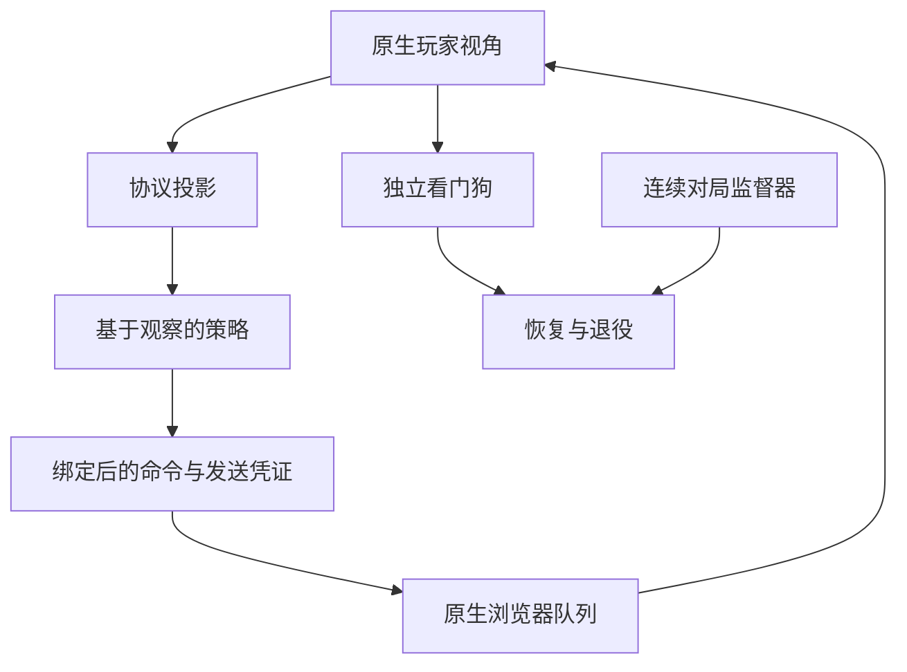

# 架构

远端 Keyteki 兼容服务器负责规则裁定。本包读取己方的原生玩家视角，从当前提供的动作中选择，编译成原生命令，并等待能够证明实际进展的后续证据。

## 模块

- `src/adapters`：玩家状态投影、原生菜单导航、分配操作、卡牌身份绑定和命令编译。
- `src/ai`：启发式策略，以及区分准备、派发和确认阶段的策略控制器。
- `src/contracts`：玩家视角和决策相关的数据类型，不包含可执行的对局状态或权威规则引擎。
- `src/knowledge`：策略使用的静态卡牌知识、数据类型和查询接口。
- `src/shared`：协议与策略边界所需的确定性序列化函数，不执行对局重放。
- `tools`：本机回环宿主、浏览器桥接、用户脚本、看门狗、房间生命周期、连续对局监督器和恢复命令。

## 发送与恢复

准备好决策、浏览器队列接受命令、在后续状态中观察到效果，是三个独立事件。网络请求返回不能单独证明游戏动作已经执行或尚未执行。页面文档 ID、控制权代次、序号、决策 ID 和发送凭证，将每个阶段绑定到同一个控制方和同一条具体动作。

已观察回执恢复流程，只有在宿主保留了完整原始派发的精确证明时，才能清除送达不确定状态。它不会重放原命令，也不会额外制造一次效果确认。对账后，旧页面仍保持暂停，直到受控刷新完成，并接受新的完整原生状态。回执缺失或不匹配、控制方变化、存在待处理命令、存储失败或操作者暂停，都会保留不确定状态。

看门狗独立于普通策略请求队列观察原生进展。连续对局监督器控制后续开局及健康阈值，不会绕过对局内尚未解决的发送不确定性。

## 信息边界

策略可使用己方可见的手牌和档案，以及对手公开信息。它不会接收对手隐藏区域、服务器随机数状态或权威对局状态对象。完整静态卡牌知识不会提供当前对局中隐藏的物理牌顺序或身份。

历史战绩与当前版本验证分开记录。本独立包实际执行过哪些检查，见[验证记录](validation.md)。
