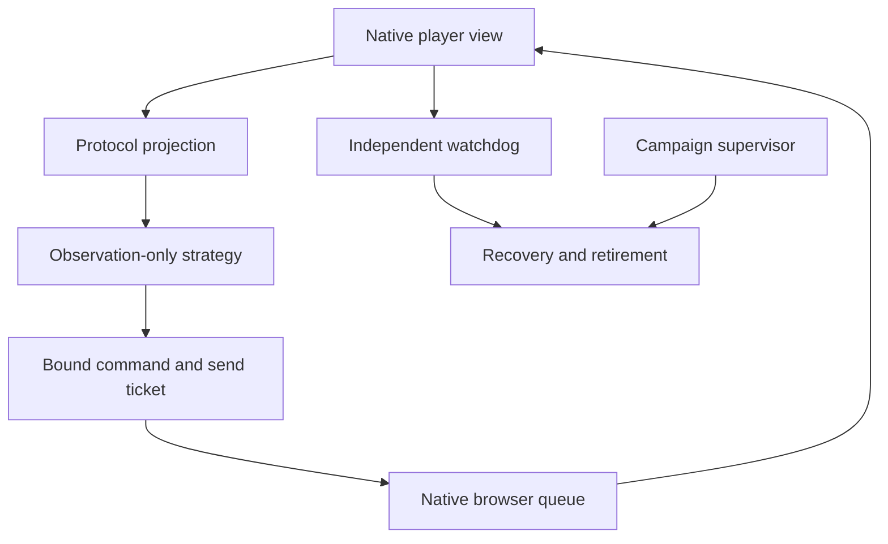

# Architecture

The remote Keyteki-compatible server is the referee. This package reads the
player's own native view, chooses from the current offered actions, compiles a
native command, and waits for evidence of progress.

## Modules

- `src/adapters`: player-state projection, native menu navigation, allocation,
  card identity binding, and command compilation.
- `src/ai`: heuristics and the prepare/dispatch/acknowledge strategy controller.
- `src/contracts`: public observation and decision types, without an executable
  game state or authoritative rule engine.
- `src/knowledge`: the explicitly scoped strategy-knowledge contract and data.
- `src/shared`: deterministic serialization needed by the protocol and strategy
  boundaries; it does not execute a game replay.
- `tools`: loopback host, browser bridge, user script, watchdog, room lifecycle,
  campaign supervisor, and recovery commands.

## Sending and recovery

Prepared decisions, commands accepted by the browser queue, and effects
observed in a later state are separate events. A network return is not proof
that an action was or was not executed. Document IDs, owner epochs, sequence
numbers, decision IDs and send tickets bind each phase to one owner and one
specific action.

The observed-receipt recovery path can clear uncertain delivery only when the
host retains exact proof for the complete original delivery. It does not
replay the original command or fabricate another effect acknowledgement.
After reconciliation the old page stays paused until a controlled reload and
fresh full native state have been accepted. A missing or mismatched receipt,
changed owner, pending command, storage failure or operator pause preserves
the uncertainty.

A watchdog observes native progress independently of the ordinary strategy
request queue. The campaign supervisor controls successive runs and health
thresholds; it does not bypass an uncertain in-game send.

## Information boundary

The strategy receives its own visible hand and archives and the opponent's
public information. It does not receive the opponent's hidden zones, server
RNG state, or an authoritative game-state object. Historical scores are not
presented as current release results. See `validation.md` for the exact
validation performed on the extracted package.
